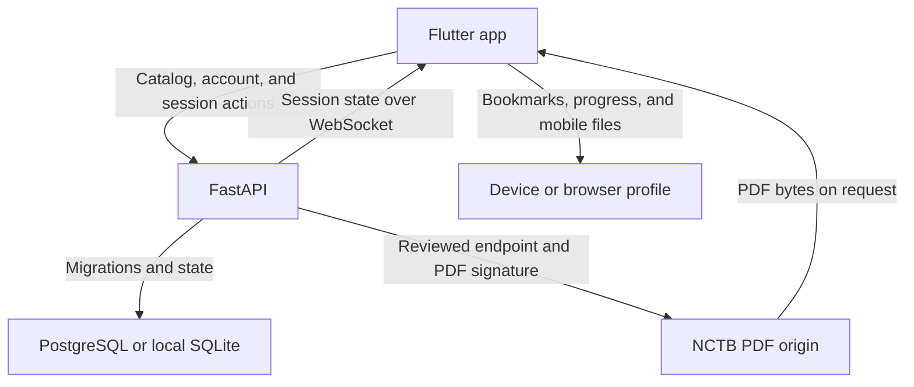

# Architecture

The guest catalog has an on-device snapshot. Public API reads return metadata and expose a direct PDF URL only for verified records. Guests can fetch a verified PDF from its origin. Browsers that block a cross-origin in-app request can open the direct source in a new tab. Native downloads finish into an app-specific file after signature, length, and trailer checks.

Teacher ink is normalized to each visible PDF page. x and y coordinates are fractions of page width and height, and line width is represented as a fraction of page width. Strokes, editable notes, and bookmarks are saved separately from the original PDF. A local document is identified by a SHA-256 fingerprint. Only its notes and progress are saved.

The database uses versioned SQL migrations and small Python connection adapters for SQLite and PostgreSQL. Versioned SQL keeps the development database portable and enables a single migration history. Startup acquires a database lock before applying migration files. Guest progress is stored through shared preferences, and PDFs use application-support files on native platforms.

## API documentation

FastAPI exposes interactive documentation at `/docs` and OpenAPI JSON at `/openapi.json`. The common API prefix is `/api/v1`.

| Access | Endpoints |
| --- | --- |
| Guest | `GET /books`, `GET /books/{id}`, `GET /search`, `GET /classes`, `GET /subjects`, `GET /years`, `POST /reports` |
| Account | `POST /auth/login`, `POST /auth/register`, `POST /auth/refresh`, `POST /auth/logout` |
| Classroom guest | `GET /classrooms/{code}`, `WS /classrooms/{code}/ws` |
| Session owner | `POST /classrooms`, `PATCH /classrooms/{code}/page`, `POST /classrooms/{code}/end` |
| Administrator | `GET /admin/books`, `POST /admin/books`, `PATCH /admin/books/{id}`, `DELETE /admin/books/{id}`, `POST /admin/books/{id}/verify`, `GET /admin/stats`, `GET /admin/reports`, `PATCH /admin/reports/{id}/resolve`, `GET /admin/audit` |

Catalog filters are `q`, `year`, `class_id`, `version`, `subject`, `track`, `offset`, and `limit`. A catalog write sends the full editable book record. `DELETE /admin/books/{id}` archives the entry and preserves related history. A verified record returns to the selected review state when edited.

Teacher updates go through authenticated HTTP with server-checked session ownership. The read-only WebSocket streams the stored state and checks for revisions every second. Students join with a temporary code, and the server stores zero student identities. Classrooms expire two hours after creation.

## Deployment review

Use HTTPS, explicit CORS and WebSocket origins, production secrets, and a private PostgreSQL connection. Run the API behind a reverse proxy with request-size caps and shared rate limits. The included in-process counters are scoped to one server process. Review access logs so they avoid recording authorization headers and account forms, and apply a retention policy to reports, expired tokens, and classroom records. Run the PostgreSQL CI job and device QA before launch.

The link verifier resolves allowlisted hosts and opens TLS with the original hostname at a checked public address. The service rejects redirects during validation and reads only a small signature prefix. Publish a reviewed direct URL after confirming edition, access, and applicable distribution terms. A matching PDF signature confirms the file type. Human review establishes authorship, edition, and permitted use.

At higher traffic, replace per-connection database polling with shared publish/subscribe, attach a connection pool to PostgreSQL, and load-test the classroom path. Catalog search tolerates a one-character insertion, deletion, or substitution and normalizes Bangla digits. Both pagination and a local snapshot cap are implemented. A larger multi-year catalog benefits from a server-side search index and cache revisioning.
